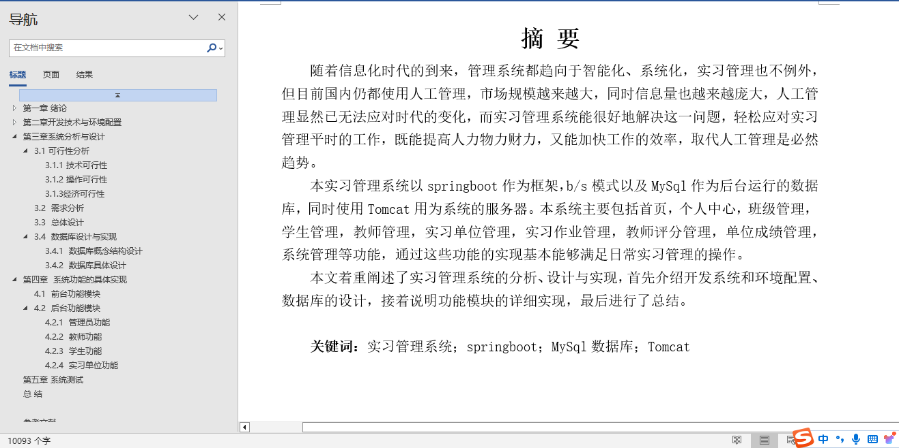
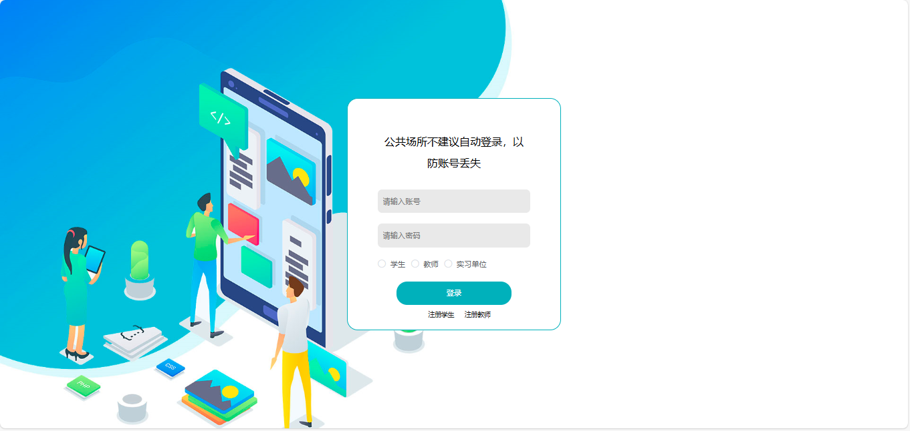
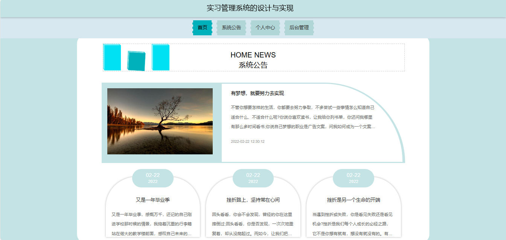
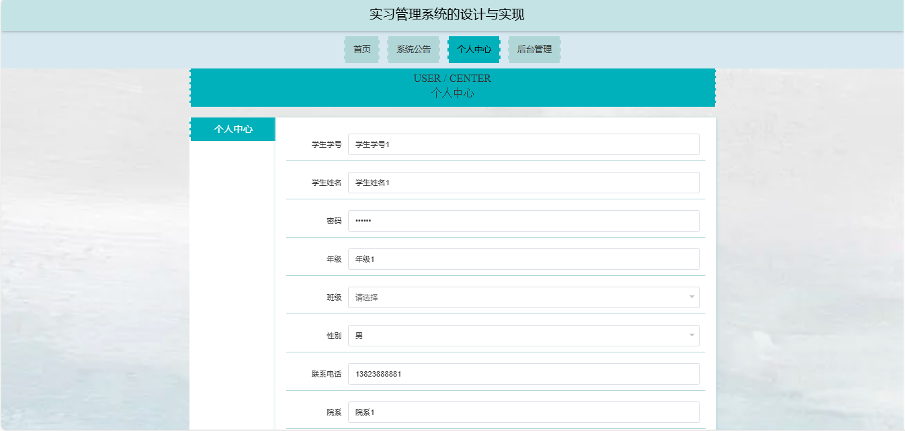
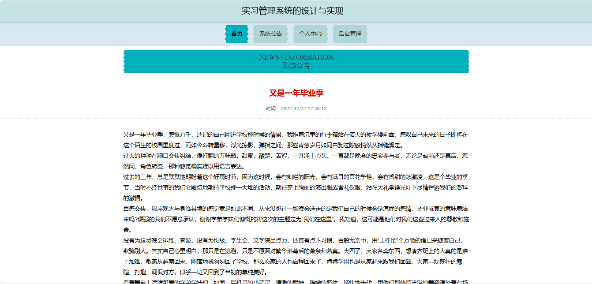
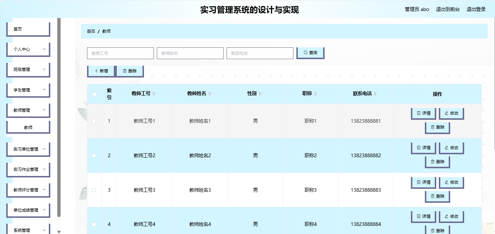
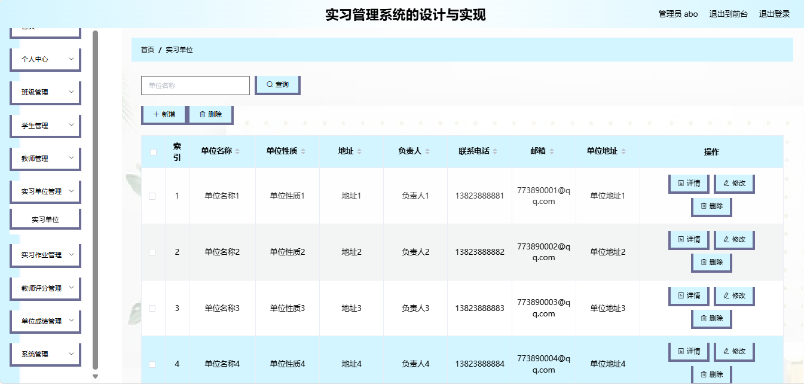
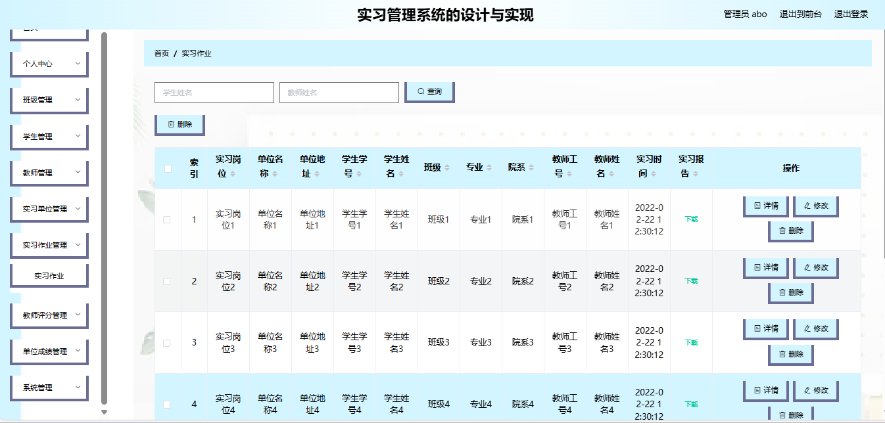
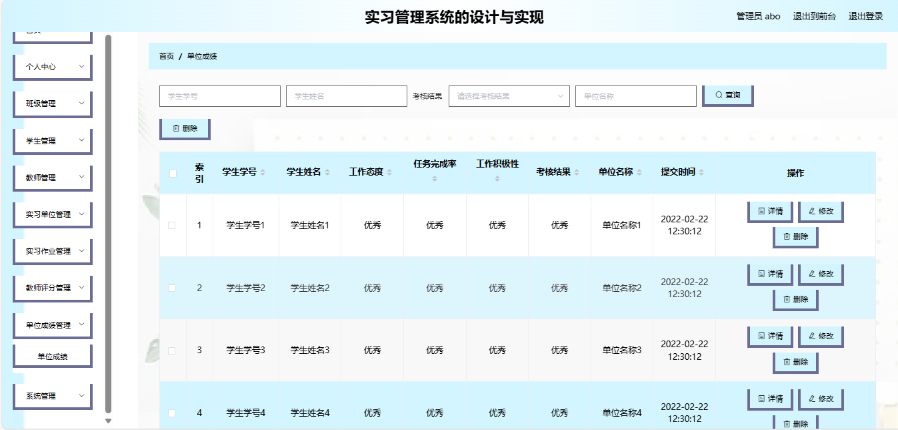

## 基于springboot的实习管理系统(程序+报告)

###  获取完整源码和sql数据库文件（完全免费）:  微信: littlepinia88 qq：1104515926
###  所有项目以及源代码本人均调试运行无问题 可支持远程安装部署调试、定制修改、代码讲解

## 项目介绍

本项目是一个基于 Spring Boot 的实习管理系统，面向高校学生外出实习的全流程线上管理场景，覆盖学生、实习单位、指导教师、管理员四方协作：学生提交实习作业与实习报告，实习单位出具单位成绩与工作证明，指导教师在线评分与评价，后台统一维护班级、师生与单位档案，采用「用户端静态页面 + 后台 Vue 管理端 + 后端 REST 接口」的前后端分离结构，打通了实习报名信息登记、作业提交、单位考核、教师评分的完整实习业务闭环。后端基于 Spring Boot + MyBatis-Plus 提供 JSON 接口，后台管理端使用 Vue2 + ElementUI 单页应用，用户端为 Layui + ElementUI 静态 HTML 页面，属于典型的 Java Web 前后端分离项目，可直接作为课程设计、毕业设计或 Spring Boot 入门实践案例。

### 系统角色
- **管理员**：登录后台管理端，维护学生、教师、实习单位、班级、实习作业、单位成绩、教师评分与系统公告。
- **学生**：凭学号登录用户端，填写实习岗位信息并提交实习报告附件，查看单位成绩与教师评分。
- **实习单位**：凭单位账号登录用户端，为所接收的学生填写单位成绩、工作证明与考核结果。
- **指导教师**：凭工号登录用户端，对所带学生的实习进行评分与文字评价。
- **权限控制**：由 `AuthorizationInterceptor` 基于 Token 统一拦截，请求头携带 `Token`，登录成功后签发令牌并写入 `token` 表；标注 `@IgnoreAuth` 的登录、注册、公开列表与详情接口放行，其余接口需携带有效 Token。

### 用户端功能
1. **注册与登录**：学生凭学号、教师凭工号、实习单位凭单位账号分别登录，登录成功后后端签发 Token，支持退出与密码重置。
2. **实习作业提交**：学生填写实习岗位、实习单位名称与地址、实习时间，上传实习报告附件，系统自动带出所在班级、专业、院系与指导教师。
3. **单位成绩查看**：学生查看实习单位给出的工作态度、任务完成率、工作积极性、考核结果与工作证明。
4. **实习评分查看**：学生查看指导教师给出的实习评分、批改时间与实习评价。
5. **公告浏览**：查看后台发布的系统公告列表与详情。
6. **个人中心**：各角色用户均可在个人中心修改本人资料与密码。

### 管理端功能
1. **管理员登录 / 注销**：管理员账号登录后台，登录态基于 Token 校验，支持退出。
2. **学生管理**：对学生（`xuesheng`）按学号、年级、班级、院系、专业分页查询、新增、编辑与删除。
3. **教师管理**：对指导教师（`jiaoshi`）按工号、职称分页维护。
4. **实习单位管理**：对实习单位（`shixidanwei`）按单位性质、地址、负责人分页维护。
5. **班级管理**：维护班级字典（`banji`）。
6. **实习作业管理**：查看学生提交的实习报告与实习岗位信息。
7. **单位成绩与教师评分管理**：查看单位录入的考核成绩与教师录入的实习评分记录。
8. **公告管理**：发布与维护系统公告（标题、简介、封面、内容）。

### 技术栈
- **后端框架**：Spring Boot 2.2.2.RELEASE、Spring MVC，JDK 1.8
- **数据访问**：MyBatis-Plus 2.3（mybatis-spring-boot-starter 2.1.1），MySQL 数据库，Mapper XML 位于 `classpath*:mapper/*.xml`
- **前端**：管理端 Vue 2.6 + Element-UI 2.13 + Vue Router + Axios（Vue CLI 4 构建）；用户端为 Layui + ElementUI 静态 HTML 页面
- **工程能力**：统一 `R` 响应模型、`AuthorizationInterceptor` Token 鉴权、`@IgnoreAuth` 注解放行、FastJSON、Hutool、Commons-IO 文件上传
- **构建运行**：Maven 构建，`spring-boot-maven-plugin` 打包；前端工程位于 `src/main/resources/admin/admin`，`npm run serve` 开发、`npm run build` 打包进 `dist`

### 核心数据表
- `xuesheng` 学生表：学生学号 `xueshengxuehao`、学生姓名 `xueshengxingming`、密码 `mima`、年级 `nianji`、班级 `banji`、性别、联系电话、院系 `yuanxi`、专业 `zhuanye`
- `jiaoshi` 教师表：教师工号 `jiaoshigonghao`、密码 `mima`、教师姓名 `jiaoshixingming`、性别、职称 `zhicheng`、联系电话
- `shixidanwei` 实习单位表：单位名称 `danweimingcheng`、密码、单位性质 `danweixingzhi`、地址、负责人 `fuzeren`、联系电话、邮箱
- `banji` 班级表：班级名称 `banji`
- `shixizuoye` 实习作业表：实习岗位 `shixigangwei`、单位名称、学生学号/姓名、班级、专业、院系、教师工号/姓名、实习时间 `shixishijian`、实习报告附件 `shixibaogao`
- `danweichengji` 单位成绩表：学生学号/姓名、工作态度 `gongzuotaidu`、任务完成率 `renwuwanchenglv`、工作积极性 `gongzuojijixing`、考核结果 `kaohejieguo`、单位名称、提交时间 `tijiaoshijian`、工作证明 `gongzuozhengming`
- `jiaoshipingfen` 教师评分表：单位名称、教师工号/姓名、学生学号/姓名、实习评分 `shixipingfen`、批改时间 `pigaishijian`、实习评价 `shixipingjia`
- `news` 系统公告表：`title`、`introduction`、`picture`、`content`

### 工程结构
```
A016springbootrij2p
├── src/main/java/com
│   ├── controller/     REST 控制器（学生、教师、实习单位、班级、作业、成绩、评分、公告等）
│   ├── service/        业务接口与 impl 实现
│   ├── dao/            MyBatis-Plus Mapper 接口
│   ├── entity/         Entity/Model/View/VO 四层实体
│   ├── config/         InterceptorConfig、MybatisPlusConfig 等配置
│   ├── interceptor/    AuthorizationInterceptor Token 鉴权
│   ├── annotation/     IgnoreAuth 免登录注解
│   └── utils/          R、分页、文件、Token 等工具类
├── src/main/resources
│   ├── mapper/         MyBatis Mapper XML
│   ├── admin/admin/    后台 Vue2 + ElementUI 工程（src/views/modules + dist 打包产物）
│   ├── front/front/    用户端静态 HTML 页面（pages/ + layui + elementui）
│   ├── static/upload/  本地上传文件目录
│   └── application.yml  端口、上下文路径、数据源、MyBatis-Plus 配置
├── screenshot/         运行截图
└── pom.xml
```

### 访问入口
- 后台管理端（打包后）：`http://localhost:8080/springbootrij2p/admin/admin/dist/index.html`
- 用户端首页：`http://localhost:8080/springbootrij2p/front/front/index.html`
- 后台前端开发调试：`http://localhost:8081`（Vue CLI dev server，代理 `/springbootrij2p` 到 8080）
- 后端接口前缀：`http://localhost:8080/springbootrij2p`

### 补充说明
- 端口、上下文路径（`/springbootrij2p`）与数据库连接均在 `src/main/resources/application.yml` 中配置（默认库 `a016_springbootrij2p`，root/123456），首次运行需按本机 MySQL 调整账号密码并先导入 SQL 脚本建表。
- 密码以明文形式入库，登录后仅以 Token 标识身份，未引入 Shiro/Spring Security 等权限框架。
- 实习报告附件与公告图片保存在本地磁盘 `static/upload/`，部署时需保证目录可写。

## 运行环境
- JDK版本：JDK1.8及以上
- 开发工具：IDEA、Ecplise、Myecplise都可以
- 数据库: MySQL5.7及以上
- Node：14.14.0及以上

## 运行截图

















